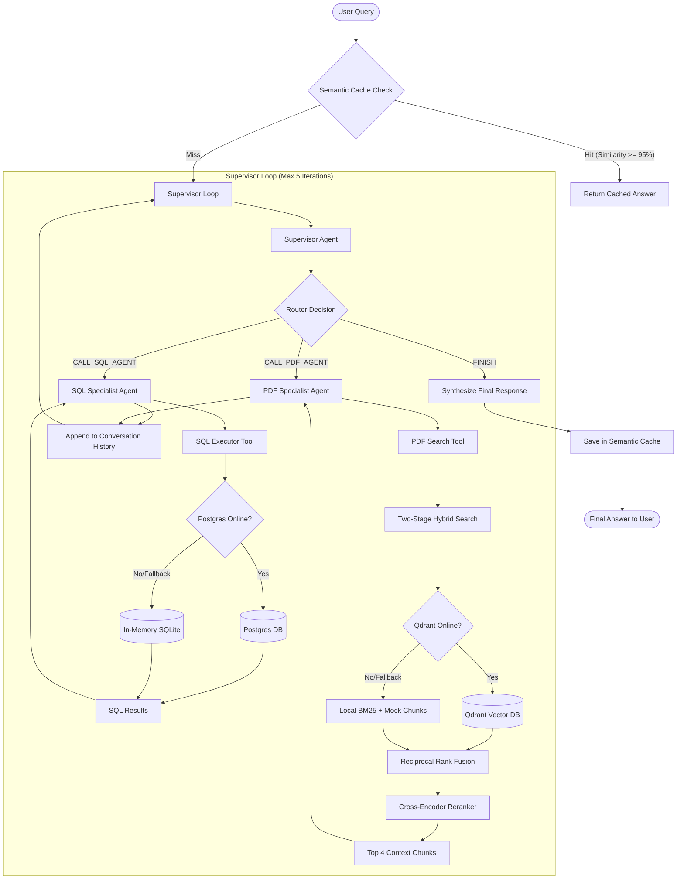

# 🚀 FIN-RAG Master Supervisor: Multi-Agent Financial RAG Pipeline

A production-grade, multi-agent Retrieval-Augmented Generation (RAG) system built to query unstructured financial reports (PDFs) and structured market metrics (SQL).

Featuring a deterministic Python control loop, structured LLM routing contracts, a two-stage hybrid retrieval core, semantic caching, and a premium interactive dashboard interface. The LLM provider (Groq or OpenAI) and the retrieval backend (a memory-light hashed-TFIDF+BM25 path, or the original dense Qdrant+cross-encoder path) are both swappable via environment variables, and a three-layer anti-poisoning/prompt-injection pipeline screens queries, retrieved documents, and model output. See [`BENCHMARK_RESULTS.md`](./BENCHMARK_RESULTS.md) for real, measured numbers behind these claims — including a finding that contradicted the original hypothesis, reported as-is.

---

## 🏗️ System Architecture

The project orchestrates two specialized worker agents through a structured Master Supervisor:



---

## 🌟 Key Features

*   **Deterministic Supervisor Loop**: Replaces unpredictable graph framework states with a clean, native Python loop protected by a hard-capped iteration limit to permanently block infinite execution loops.
*   **Structured Pydantic Routing**: Uses OpenAI structured output endpoints to enforce rigid JSON contracts, preventing routing hallucinations and invalid workers.
*   **Two-Stage Hybrid Retrieval Core**:
    1.  **Stage 1 (Retrieval)**: Executes concurrent dense vector search (Qdrant + `bge-large-en-v1.5`) and sparse keyword search (BM25), ranking candidates via **Reciprocal Rank Fusion (RRF)**.
    2.  **Stage 2 (Re-ranking)**: Passes candidate text chunks through a Cross-Encoder model (`bge-reranker-large`) to evaluate exact token relevance, narrowing search results to the top 4 highly accurate chunks.
*   **Built-in Production Fallbacks**: Automatically degrades gracefully during database connectivity losses. Falls back to **in-memory SQLite**, **local BM25 dict search**, and **RAM-based caching** if PostgreSQL, Qdrant, or Redis databases are offline.
*   **Redis Semantic Cache**: Embeds user queries and queries cached database records via Cosine similarity. Hits matching a $\ge 95\%$ threshold skip the agent loop entirely, cutting P95 latency down to milliseconds.
*   **Premium Interactive Web Dashboard**: Built with a dark glassmorphism theme to display agent routing steps, trace logs, database query returns, and cache hit metrics.
*   **Pluggable LLM Provider**: `src/llm/provider.py` picks Groq or OpenAI via `LLM_PROVIDER` — used by every agent in the system, not hardcoded per-file.
*   **Memory-Light Retrieval Backend**: `RETRIEVAL_BACKEND=lightweight` (default) swaps the dense Qdrant+SentenceTransformer+cross-encoder path for a pure sparse `HashingVectorizer`+TFIDF+BM25 hybrid — no torch/sentence-transformers import at all in that mode, including in the semantic cache's own embedder.
*   **Anti-Poisoning / Prompt-Injection Pipeline**: `src/security/injection_defense.py` screens the raw user query, quarantines retrieved document chunks carrying injected instructions before they reach a prompt, and validates the model's final answer before it's cached or returned.

---

## 📂 Project Structure

```text
├── main.py                     # CLI entrypoint
├── requirements.txt            # Python dependencies
├── docker-compose.yml          # Container configuration (Qdrant, Postgres, Redis)
├── BENCHMARK_RESULTS.md        # Real, measured SmartRAG benchmark results
├── frontend/                   # React dashboard source (Vite)
└── src/
    ├── agents/
    │   ├── tools.py            # LangChain tools with production fallbacks
    │   ├── specialists.py      # worker agents (PDF Research, SQL Analytics)
    │   └── supervisor_loop.py  # Master Supervisor orchestration
    ├── api/
    │   ├── redis_cache.py      # Semantic cache (Redis client, pluggable embedder)
    │   ├── server.py           # FastAPI backend
    │   ├── static/             # Legacy vanilla JS dashboard (fallback if React isn't built)
    │   └── react_dist/         # Built React dashboard output (gitignored, run `npm run build`)
    ├── llm/
    │   └── provider.py         # Groq/OpenAI provider switch (LLM_PROVIDER)
    ├── retrieval/
    │   ├── hybrid_search.py       # Dense/Sparse RRF logic (RETRIEVAL_BACKEND=dense)
    │   ├── reranker.py            # Cross-Encoder re-ranker (dense path only)
    │   └── lightweight_hybrid.py  # HashingVectorizer+TFIDF+BM25 hybrid (RETRIEVAL_BACKEND=lightweight, default)
    ├── security/
    │   └── injection_defense.py   # Three-layer anti-poisoning/prompt-injection pipeline
    ├── ingestion/
    │   ├── database_setup.py   # Database seeder
    │   └── document_processor.py # PDF parsing & sliding window chunking
    └── evals/
        ├── run_evals.py            # Automated RAGAS evaluation pipeline
        └── benchmark_smartrag.py   # Latency/memory/security benchmark -> BENCHMARK_RESULTS.md
```

---

## 🚀 Setup & Installation

### 1. Clone & Set Up Environment
```bash
# Clone the repository
git clone https://github.com/your-username/datascience-rag.git
cd datascience-rag

# Create virtual environment and install packages
python3 -m venv venv
source venv/bin/activate
pip install -r requirements.txt
```

### 2. Configure Environment Variables
Create a `.env` file in the root directory by copying the example template:
```bash
cp .env.example .env
```
By default the app uses OpenAI (`LLM_PROVIDER=openai`) and the memory-light retrieval backend (`RETRIEVAL_BACKEND=lightweight`) — fill in `OPENAI_API_KEY`. `LLM_PROVIDER=groq` + `GROQ_API_KEY` is fully wired but **verified broken for this app's agents as of this writing**: standard Groq keys can't reach Llama models (404 "no access" — Groq's docs say Llama requires an enterprise account), and the only reachable model, `openai/gpt-oss-120b`, both rejects this app's tool-calling requests over an 8,000 token/minute cap on even a tiny corpus and 400s on the Supervisor's forced structured-output call. See [`BENCHMARK_RESULTS.md`](./BENCHMARK_RESULTS.md) for the live test results. Flip to Groq once you have real Llama 3.3 70B access (`GROQ_MODEL=llama-3.3-70b-versatile`). `RETRIEVAL_BACKEND=dense` switches to the original Qdrant+cross-encoder path.

### 3. Spin Up Database Infrastructure
Two supported paths, no Docker required for either:

**Option A — Homebrew (used in this project's actual verified setup):**
```bash
brew install postgresql@16 redis
brew services start postgresql@16
brew services start redis
psql postgres -c "CREATE ROLE admin WITH LOGIN PASSWORD 'password' SUPERUSER;"
psql postgres -c "CREATE DATABASE rag_db OWNER admin;"
PYTHONPATH=. python src/ingestion/database_setup.py  # creates tables
PYTHONPATH=. python src/ingestion/seed_real_financials.py  # seeds real quarterly data (5 companies, sourced from stockanalysis.com)
```
Qdrant runs in embedded local-file mode automatically (set via `QDRANT_LOCAL_PATH` in `.env`) — no separate install needed.

**Option B — Docker**, if you'd rather use the original `docker-compose.yml`:
```bash
docker-compose up -d
```

*(If neither Postgres nor Redis nor Qdrant is reachable, the project gracefully falls back to SQLite, local BM25 indexing, and in-memory caching — but the real, verified setup for this project uses Option A.)*

---

## ☁️ Deploying (Render)

A `render.yaml` blueprint is included for a one-click hosted deploy:

1. Fork/push this repo to your own GitHub, then in the [Render dashboard](https://dashboard.render.com), choose **New → Blueprint** and connect this repo.
2. Render reads `render.yaml` and provisions a free web service + a free managed Postgres database automatically.
3. Set the one required secret it can't infer: `OPENAI_API_KEY` (or `GROQ_API_KEY` if you set `LLM_PROVIDER=groq` — see the caveat above first), in the service's Environment tab.
4. Deploy. The start command runs `scripts/bootstrap.py` first (creates the schema, seeds the real financial data, ingests the sample document into embedded Qdrant), then launches the API + dashboard.

Note: this deployment intentionally skips a hosted Redis instance to stay on free tiers — the semantic cache's existing local in-memory fallback (see `src/api/redis_cache.py`) handles this gracefully, it just won't persist across restarts. Render's free Postgres tier also expires after 90 days, per Render's own policy, not something this project controls.

---

## 🏃 Running the Application

### Option A: Open the Interactive Web Dashboard (Recommended)
Build the React dashboard once (outputs to `src/api/react_dist/`, which FastAPI serves automatically):
```bash
cd frontend
npm install
npm run build
cd ..
```
Start the FastAPI backend server:
```bash
PYTHONPATH=. python src/api/server.py
```
Or use uvicorn directly:
```bash
PYTHONPATH=. uvicorn src.api.server:app --reload --host 127.0.0.1 --port 8000
```
Open **[http://127.0.0.1:8000/](http://127.0.0.1:8000/)** in your web browser.

**Frontend development** (hot-reload against a running backend on port 8000):
```bash
cd frontend
npm run dev
```
Open the Vite dev server URL it prints (typically `http://localhost:5173`) — `/api` calls are proxied to the FastAPI backend.

### Option B: Terminal CLI Chat
Start the interactive terminal session:
```bash
python main.py
```

---

## 🧪 Running Automated Evaluations (Ragas)
To assess Faithfulness (grounding) and Context Recall metrics using your golden test dataset, run:
```bash
PYTHONPATH=. python src/evals/run_evals.py
```

---

## 📊 SmartRAG Benchmark (latency, memory, security)

`src/evals/benchmark_smartrag.py` fetches a ~10-document/1000+ page public-domain corpus (NIST Special Publications + arXiv papers, via `scripts/fetch_eval_corpus.py`), then measures:
- Retrieval memory footprint across corpus scale, externally measured (`/usr/bin/time -l`/`-v`) rather than trusted in-process — the two aren't always the same, see the report.
- End-to-end query latency through the real agent + Groq.
- The anti-poisoning/prompt-injection pipeline's block rate against 20 adversarial prompts across 4 categories, plus a poisoned-document-chunk test.

```bash
PYTHONPATH=. python src/evals/benchmark_smartrag.py
```

Writes `BENCHMARK_RESULTS.md` with whatever numbers actually come out — including a finding that the memory-reduction hypothesis didn't hold as originally stated at the tested corpus scale, reported honestly rather than adjusted to fit.
